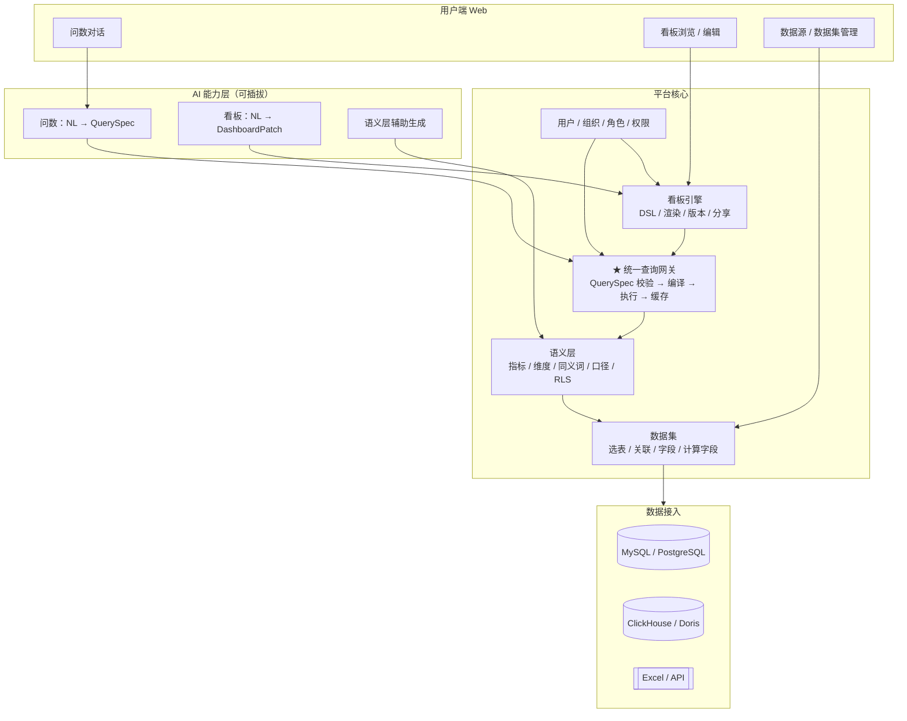

# 01 · 总体设计

## 1. 目标

从零建设一个**数据看板平台**：业务同学用自然语言问数、把结果沉淀成看板；数据同学管理数据源和指标口径；平台本身具备权限、目录、分享等基础能力。

> 定位：**AI 原生，但首先是一个能用的平台。** AI 是加速器，不是地基。

---

## 2. 平台全景

平台 = **平台底座** + **AI 能力层**。两者的关系是硬约束：

- 底座**没有 AI 也必须能用**（能接库、能配指标、能看图）
- AI **没有底座就是玩具**（不能查、不能渲染、不能管权限）



---

## 3. 三个决定成败的架构决策

### 决策一：所有查询走同一个「统一查询网关」

```
人工搭建的看板:   图表配置  ──▶ QuerySpec ──▶ 网关
AI 问数:          自然语言  ──▶ QuerySpec ──▶ 网关
```

**同一个 QuerySpec schema、同一个编译器、同一个缓存。**

为什么重要：AI BI 产品最常见的翻车方式是「AI 算出来的数和看板上的数对不上」——因为它有两条独立的取数逻辑。我们只允许一条。这样：

- 数字天然一致，不需要对账
- 缓存共享，AI 问过的问题看板直接命中
- 权限只有一处注入点，不会漏
- 评测体系同时覆盖两条路径

### 决策二：两级建模（数据集 → 语义模型）

| 层 | 面向谁 | 内容 | 例子 |
|---|---|---|---|
| **数据集 Dataset** | 数据工程 | 选哪些表、怎么 join、字段类型、计算字段 | `fact_order` + `dim_user` 关联 |
| **语义模型 Semantic** | 业务 / 分析师 | 指标定义、维度、同义词、口径、权限 | GMV = `sum(paid_amount) where status='paid'` |

**为什么要分两级**：数据集是物理映射，改表结构时只动这一层；语义模型是业务抽象，业务说「GMV 口径变了」只动这一层。合并成一级的话，任何变更都会互相牵连。

> P0 实现可以先合并为一个 YAML 文件（语义模型内直接写 `table` / `column`），但**代码里的概念边界要预留**，Phase B 再拆开。

### 决策三：看板是声明式 JSON

看板不存 SQL、不存查询结果，只存 `QuerySpec + 布局 + 图表配置`。

- 相对时间（`last_month`）在**编译时**解析 → 看板数字每天自动滚动
- 指标口径改了 → 看板自动跟着变
- 任何卡片都能回放「这个数怎么算的」
- AI 生成和人工拖拽产出**同一种结构**，可以互相编辑

---

## 4. 分层职责

| 层 | 职责 | 明确不做 |
|---|---|---|
| 数据接入 | 连接管理、元数据采集、字段抽样、方言适配 | ETL / 数仓建模（复用已有数仓） |
| 数据集 | 物理表 → 逻辑模型 | 业务口径 |
| 语义层 | 业务指标定义、维度、同义词、权限 | 存数据 |
| 查询网关 | QuerySpec → SQL → 执行 → 缓存 | 渲染 |
| 看板引擎 | DSL、渲染、版本、分享 | 定义口径 |
| AI 层 | NL → QuerySpec、NL → DashboardPatch | 直接写 SQL、绕过网关 |
| 平台管理 | 用户、组织、角色、目录、审计 | — |

---

## 5. 平台能力清单

| 能力 | MVP（P0） | V1 | V2 |
|---|---|---|---|
| 数据源管理 | 单数据源，配置文件 | 多数据源 + UI 管理 | 数据源级权限 |
| 数据集 | 语义 YAML 内联 | 独立数据集管理 UI | 计算字段、跨源 |
| 语义层 | YAML 文件 + 校验 | UI 编辑 + 版本 | AI 辅助生成草稿 |
| 问数 | 单轮 + 修正 | 多轮、下钻、追问 | 主动洞察 |
| 看板 | Pin + 栅格 + 分享链接 | 拖拽编辑、筛选联动 | 订阅、嵌入、大屏 |
| 权限 | 简单 RLS | RBAC + 组织树 | 行列级、空间级 |
| 调度 | 无 | 定时刷新 + 缓存预热 | 数据质量监控 |
| 审计 | 无 | 查看/查询日志 | 合规导出 |

---

## 6. 六个工程机制

1. **语义层是唯一业务事实**：同一份 YAML 被问数引擎、编译器、看板、治理四处消费，改口径只改一处。
2. **LLM 只做规划不做执行**：输出结构化 QuerySpec，SQL 由确定性编译器生成，可复现、可评测、天然防注入。
3. **权限编译期注入**：行级 `region IN ({{ user.regions }})` 拼进 WHERE，列级在结果返回前脱敏，绝不写进 prompt。
4. **准确率工程化**：语义层收窄候选 → 实体链接 → 静态校验（EXPLAIN）→ 失败带错重试（≤2 次）→ 结果合理性校验 → 澄清。
5. **评测驱动**：50~200 条「问题 → 期望 QuerySpec → 期望答案」，CI 回归。没有评测集就是盲改。
6. **缓存分层**：查询结果缓存（按 spec hash + 数据版本）+ 语义层/元数据常驻内存。

---

## 7. 端到端数据流

```
用户: "看看 9 月直播渠道的 GMV 趋势，和 8 月比一下"
  │
  ├─ 1. 归一化     → 补全指代、识别时间基准年
  ├─ 2. 意图识别   → trend + period_compare
  ├─ 3. 实体链接   → gmv / channel=直播 / order_date: 2026-09
  ├─ 4. 槽位校验   → 粒度缺省 day；对比类型 = 上一周期
  ├─ 5. 规划       → QuerySpec
  ├─ 6. 网关       → 编译 SQL（注入 RLS）→ 预检 → 执行 → 缓存
  ├─ 7. 结果校验   → 空？离群？量级突变？
  ├─ 8. 表达       → 折线图 + 文字结论 + 口径/SQL 可展开
  └─ 9. 沉淀       → 📌 → ChartCard → 草稿看板 → 发布 → 分享
```

---

## 8. 非目标

| 不做 | 原因 |
|---|---|
| 通用 ETL / 数据集成 | 复用已有数仓或 CDC 工具 |
| 实时流计算 | 批处理 + 定时刷新足够 |
| 一句话生成整块大屏 | 先做「草稿 + 微调」，不追求无人干预 |
| 微服务 / 多租户 SaaS | 单体模块化起步，边界稳定后再拆 |
| 移动端 | Web 响应式优先 |

---

## 9. 为什么不做成「在别人平台上加 AI」

如果有存量 BI，最省事的做法是只做 AI 层、把图表推给现有平台。但你们没有存量平台，而且核心诉求就是「平台 + AI 原生」，所以：

- 表达层必须自建（图表渲染、看板 DSL、布局）
- 数据接入必须自建（连接、元数据、执行）
- 因此**统一查询网关**从第一天就要有，否则后面 AI 和 BI 两条路会分叉

代价是工作量约 **2.5~3 倍**于「嵌入式」方案，收益是产品形态由自己定义。

> **单人约束**：本项目由一名开发者从零建设，因此路线图按「一条竖切、逐层加厚」重排，
> 并附了明确的砍掉清单，避免做成「什么都做了一半」的平台。详见 [04-单人开发路线](04-单人开发路线.md)。
