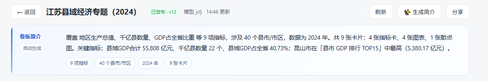
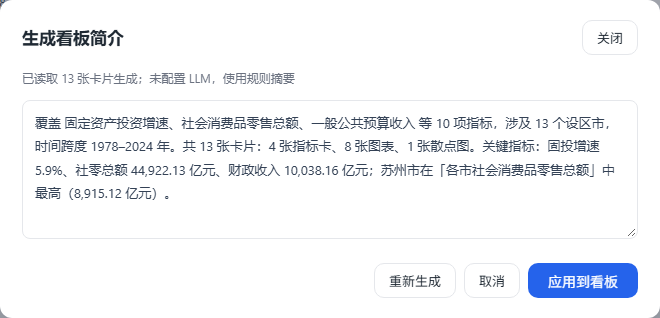

# 03 · 看板沉淀

> 核心思路：**问数不是用完即弃，好问题应该沉淀成看板资产。**

---

## 一、数据模型

```
Session ──▶ QuerySpec ──▶ QueryResult
                 │
                 ▼
             ChartCard ──┐
                         ├──▶ Dashboard（版本化）
             Layout ─────┘
```

| 对象 | 内容 | 是否可变 |
|---|---|---|
| `QuerySpec` | 指标、维度、过滤、时间（相对时间） | 不可变，改了就是新 spec |
| `ChartCard` | QuerySpec + 图表类型 + 标题 + 布局格子 | 可变 |
| `Dashboard` | 过滤器 + 卡片列表 + 布局 + 版本 | 可变（有版本历史） |

**关键**：看板卡片里**不存 SQL、不存结果数字**，只存 QuerySpec。这样：

- 口径改了，看板自动跟着变
- 相对时间（「近 30 天」）每天重新解析，数字自动滚动
- 任何时候可以回放「这个数怎么算的」

---

## 二、三条沉淀路径

### 路径 A：单图沉淀（最高频）

用户问数 → 结果卡片右上角 `📌 固定` → 选择看板 → 生成 ChartCard。

交互细节：
- 默认标题 = 「{指标}按{维度}」+ 时间范围
- 默认图表由推断规则决定（见第三节）
- 若目标看板已有同 QuerySpec 的卡片，提示「已存在，是否覆盖」

### 路径 B：会话沉淀

把一次多轮对话的结果一起打包成看板草稿（「把刚才分析的都存下来」）。

### 路径 C：自然语言设计看板

用户给定主题（「做一个 9 月经营分析看板」），系统：

1. 读取语义模型里可用的指标/维度
2. 反问 2~3 个关键问题（关注哪些指标？按天还是按月？要不要对比？）
3. 生成**看板草稿**（Dashboard DSL），标记为 draft
4. 用户在预览上继续用自然语言微调

**重要**：路径 C 不追求一次生成完美，追求「生成 70% 可用的草稿，剩下靠微调」。

---

## 三、图表推断规则

LLM 可以给 `viz_hint`，但最终由规则决定，规则优先：

| 查询形态 | 默认图表 |
|---|---|
| 1 指标 + 1 时间维度 | 折线图 |
| 1 指标 + 1 时间维度 + 1 类别维度 | 多系列折线 |
| 1 指标 + 1 类别维度，类别 ≤ 8 | 柱状图 |
| 1 指标 + 1 类别维度，类别 > 8 | 条形图（横向，可滚动） |
| 2 指标 + 1 时间维度 | 双轴折线 |
| 指标含「率/占比」 | 百分比堆叠柱 / 环形图（类别 ≤ 6） |
| 只有 1 行 1 列 | 指标卡（大数字 + 环比） |
| 明细（无聚合） | 表格 |
| space 维度 = 地区 | 地图（可选，后置） |

规则之外留一个「换图表」入口，但**不把选图表交给 LLM 自由发挥**。

---

## 四、看板 DSL

```json
{
  "id": "dash_01HXYZ",
  "title": "9 月经营分析",
  "description": "9 月交易域经营复盘：GMV / 订单 / 客单价走势，渠道与地区结构，含异常波动归因。",
  "status": "draft",
  "version": 3,
  "grid": { "cols": 12, "rowHeight": 72 },
  "filters": [
    { "id": "f_date", "dimension": "order_date", "type": "date_range", "default": "last_30d" },
    { "id": "f_channel", "dimension": "channel", "type": "multi_select", "default": [] }
  ],
  "cards": [
    {
      "id": "c_gmv",
      "type": "chart",
      "title": "GMV 趋势",
      "query": "q_8f2a",
      "visualization": {
        "kind": "line",
        "x": "order_date",
        "y": ["gmv"],
        "smooth": true
      },
      "layout": { "x": 0, "y": 0, "w": 8, "h": 4 }
    },
    {
      "id": "c_region",
      "type": "chart",
      "title": "地区 TOP10",
      "query": "q_9c1b",
      "visualization": { "kind": "bar", "axis": "y", "y": ["gmv"] },
      "layout": { "x": 8, "y": 0, "w": 4, "h": 4 }
    }
  ],
  "created_by": "u_123",
  "updated_at": "2026-10-19T12:00:00+08:00"
}
```

### 约束

- `layout` 只能是 12 栅格整数坐标，**不允许像素定位**
- `visualization.kind` 是枚举，扩展要改代码，不让 LLM 发明新类型
- `query` 引用 QuerySpec id，卡片自身不内联 SQL
- `status`: `draft` → `published`，只有 published 能对外分享
- `description` 是看板简介：渲染在标题下方、卡片上方，列表页也展示；从模板创建时自动带入模板 frontmatter 的 description，可通过 PATCH 修改

简介的实际渲染效果（分享页同样带简介）：



---

## 五、自然语言编辑看板

对现有看板说人话，输出的是 **patch 列表**，不是重新生成整个看板。

### 输入
> 「把 GMV 趋势放最上面，右边加一个地区 TOP10，再加一个渠道筛选」

### LLM 输出（受控）

```json
{
  "patches": [
    { "op": "move", "card": "c_gmv", "layout": { "x": 0, "y": 0, "w": 12, "h": 4 } },
    { "op": "add_card",
      "spec": { "metrics": ["gmv"], "dimensions": ["region"],
                "order_by": [{"by":"gmv","dir":"desc"}], "limit": 10,
                "filters": [{"type":"time","range":{"type":"relative","value":"last_30d"}}] },
      "visualization": { "kind": "bar", "axis": "y", "y": ["gmv"] },
      "layout": { "x": 0, "y": 4, "w": 6, "h": 4 } },
    { "op": "add_filter", "dimension": "channel", "type": "multi_select" }
  ],
  "explanation": "已把 GMV 趋势置顶并通栏，新增地区 TOP10 卡片和渠道筛选器"
}
```

### 处理流程

1. LLM 输出 patch
2. **schema 校验**（op 白名单、字段合法、坐标不越界）
3. **冲突检测**（新增卡片和已有卡片重叠 → 自动重排）
4. 事务性应用
5. 前端预览 + 「撤销」按钮
6. 用户确认后产生新版本

### 反模式（明确禁止）

| 反模式 | 后果 |
|---|---|
| 让 LLM 直接生成 HTML / CSS | 无法维护、无法响应式、有 XSS 风险 |
| 让 LLM 决定像素布局 | 每次结果都不一样，无法回归测试 |
| 每次对话都重新生成整个看板 | 丢掉用户的手工调整 |
| 允许 LLM 随意新增图表类型 | 前端渲染崩溃 |

---

## 六、版本与血缘

### 版本

每次发布产生一个不可变版本快照：`dashboard.version` 递增，保留最近 20 个版本，可回滚。
草稿态自动保存（每 2s 防抖），不进版本历史。

### 血缘

```
看板卡片 → QuerySpec → 指标(gmv, order_cnt) → 维度(order_date) → 物理表(fact_order)
```

用途：
- 改 `gmv` 口径前，查「影响 7 个看板、3 个订阅」
- 表结构变更时，提示受影响的指标
- 回答「这个数从哪来」

---

## 七、分享与订阅

| 形态 | 说明 |
|---|---|
| 链接分享 | `published` 看板生成只读链接，权限跟随分享人（可选「以访客身份查看」） |
| 定时快照 | 每天 9:00 生成图片/PDF 推送到群（飞书/邮件） |
| 订阅 | 用户订阅指标，数值超过阈值时推送（「GMV 日环比跌幅 >20%」） |

P0 只做链接分享，订阅后置。

---

## 八、沉淀质量指标

上线后重点看这几个数：

| 指标 | 含义 | 健康值 |
|---|---|---|
| Pin 率 | 问数结果被沉淀的比例 | 5%~15% |
| 看板复用率 | 看板被查看 / 被创建 | > 5 |
| 草稿转发布率 | 生成的草稿最终发布的比例 | > 50% |
| 卡片存活率 | 30 天后仍被查看的卡片比例 | > 60% |

Pin 率过低说明生成的结果不够好；草稿转发布率低说明「自然语言生成看板」还没到可用水平，应回退到只做路径 A。

---

## 九、看板简介自动生成（2026-10-23）

简介原来靠手写，现在有三种生成/维护方式：

1. **建板即生成**：从模板创建看板时，卡片刚跑过一遍查询（缓存命中），顺手生成简介和 `description_meta`，不用再点按钮
2. **手动重生成**：看板右上角「✨ 生成简介」，弹窗里可改，确认后应用（应用 = 内容变更，看板退回 `draft`，重新走审批发布）
3. **LLM 润色**：配置 `LLM_BASE_URL` / `LLM_API_KEY` 后，规则摘要会再交给模型改写成更自然的分析口吻；没配置或调用失败自动回退规则摘要


### 9.1 规则摘要（describe.build）

1. 卡片 → 逐张跑 QuerySpec，复用 `/api/run-spec` 同一个网关，和看板取数是同一条链路
2. 提取事实：指标名（列标签去掉「各市 / 县域」前缀）、地区范围（维度值按 13 市字典 / 县市后缀判定）、时间跨度（时间列年份或相对周期）、卡片构成（指标卡 / 图表 / 地图 / 散点）
3. 拼三句：
   - 范围：覆盖 X 项指标，涉及 N 个设区市，时间跨度 1978–2024 年
   - 结构：共 13 张卡片：4 张指标卡、8 张图表、1 张散点图
   - 亮点：KPI 数值 + 降序排行的第一名
4. 单张卡查询失败只跳过该卡；一张卡片都没有时退化成一句「共 N 张卡片，展示 X 数据」

结构化事实同时存成 `description_meta`（指标数、地区、时间、卡片数、来源、生成时间），前端渲染成简介条上的 chips：



### 9.2 LLM 润色（llm.py + describe.polish）

- 客户端：`server/app/llm.py` 用标准库 `urllib` 调 OpenAI 兼容的 `/chat/completions`，不引第三方依赖
- prompt：系统提示（资深分析师、只使用给定数字、2–3 句、120–200 字、不要 markdown）+ 规则摘要 + 结构化事实
- 失败兜底：网络 / 超时 / 返回格式错误 → 回退规则摘要，接口不报错，`source` 记为 `rule`
- provenance：`source` 记 `rule / llm / manual`，简介条上标注「自动生成 / ✨ AI 润色 / 已手工调整」

配置示例（不配置也能用，只是不润色）：

```
LLM_BASE_URL=https://api.deepseek.com/v1
LLM_API_KEY=sk-...
LLM_MODEL=deepseek-chat
```

### 9.3 API

```
POST /api/dashboards/{id}/describe  {"apply": false, "polish": true}
    → {text, source, llm_available, meta}          只预览，不改看板

POST /api/dashboards/{id}/describe  {"apply": true, "text": …, "source": "llm"}
    → 写入 description + description_meta，看板退回 draft、版本 +1
```

### 9.4 示例输出（投资与消费专题，规则摘要）

> 覆盖 固定资产投资增速、社会消费品零售总额、一般公共预算收入 等 10 项指标，涉及 13 个设区市，时间跨度 1978–2024 年。共 13 张卡片：4 张指标卡、8 张图表、1 张散点图。关键指标：固投增速 5.9%、社零总额 44,922.13 亿元、财政收入 10,038.16 亿元；苏州市在「各市社会消费品零售总额」中最高（8,915.12 亿元）。

> 前端缓存：内部工具里 HTML / JS / CSS 统一 `Cache-Control: no-store`，静态资源再加 `?v=` 版本号——改样式后刷新即生效，不会出现「代码更新了但页面还是旧样子」。
