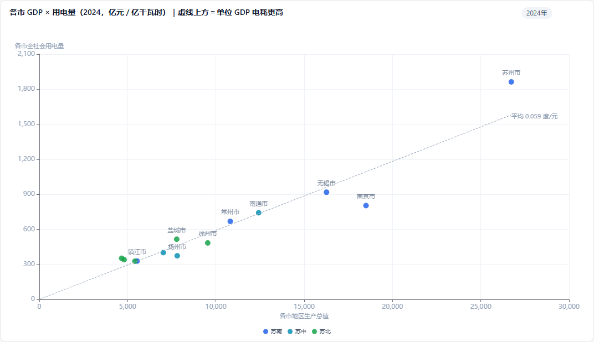

# 09 · 江苏统计年鉴数据建模分析

> 数据：工作区 `江苏省统计局历年年报数据/`（2020–2025 六个年鉴压缩包）
> 本文回答三件事：数据长什么样、表怎么设计、后续能分析什么。

> **P0 已完成（2026-10-20）**
> `tools/jsfj_etl.py` 已把 GDP / 人口 / 收入 3 类核心表抽成统一长表，写入 `fact_stat`：**1,011 行 / 25 指标**；
> `semantic/jsfj.yaml` 已接入平台，可直接问数；新增看板模板 `templates/boards/jsfj_review.yaml`。

---

## 一、数据画像

### 1.1 规模

| 项 | 数量 |
|---|---|
| 年鉴 | 6 本（2020–2025） |
| Excel 文件 | 170 个 |
| 数据表（sheet） | 2,308 张 |
| 不同表名 | 1,073 个 |
| 跨 4 本以上年鉴重复的表名 | 205 个 |
| 2020 年 HTML 页面 | 486 个（同时提供了转换后的 35 个 xlsx） |

### 1.2 篇章结构

- **2020–2022**：35 篇，其中 13 篇是「乡镇基本情况-各市」，其余 22 篇为常规统计篇章
- **2023–2024**：22 篇（取消分市乡镇文件）
- **2025**：21 篇（进一步合并）

篇章名跨年有差异，例如：
- `人口、就业和工资`（2020–2022）→ `人口就业和工资`（2023–2025）
- `文化、体育、卫生` → `文化体育卫生`

### 1.3 表形态（按表头结构分类）

| 形态 | 数量 | 说明 |
|---|---|---|
| 分地区（行=地区） | 441 | 第一列是 13 市 / 县 / 乡镇 |
| 时间序列·年在行 | 391 | 第一列是年份，如「2-1 主要年份地区生产总值」 |
| 时间序列·年在列 | 170 | 表头是多列年份 |
| 其他（结构表/交叉表） | 1,306 | 多行表头复杂，如人口年龄构成 |

### 1.4 典型结构（以 2-1 为例）

```
第 0 行：表名「2-1 主要年份地区生产总值」
第 1 行：英文表名
第 3 行：注释「本表按当年价格计算」
第 4–5 行：多行表头（含合并单元格）
  年份 | 地区生产总值 | 第一产业 | 第二产业 | ... | 人均地区生产总值(元)
第 6 行起：数据
```

**原型解析结果**：该表可抽出 **504 行**长表数据，覆盖 1952–2024，每个指标 56 个年份。

> ⚠️ 重要发现：「主要年份」表是**抽样年份**，不是连续年度序列（如 1952、1955、1957…）。
> 要做连续时间序列，必须用各年度的分表或「历年」表。

---

## 二、表怎么设计

### 2.1 总体思路：三层 + 星型

```
raw（原始保真） → dim（维度） + fact（长表事实） → ads（分析宽表）
```

**为什么必须是长表**：4 种布局（年在上/年在列/地区在行/地区在列）只有统一成
`(指标, 地区, 年份, 数值, 单位)` 才能跨表比较和钻取。

### 2.2 原始层（保真，可回溯）

```sql
CREATE TABLE raw_cell (
  yearbook   INT,      -- 年鉴年份
  file       TEXT,     -- 源文件
  sheet      TEXT,     -- 源工作表
  row_idx    INT,
  col_idx    INT,
  value_text TEXT      -- 原始单元格文本（不解析）
);
```

价值：任何解析错误都能回到原文核对；也方便换解析规则重跑。

### 2.3 维度层

```sql
-- 年鉴
dim_yearbook(yearbook, publish_date, title)

-- 篇章（注意跨年改名，用 code 对齐）
dim_chapter(chapter_code PK, chapter_name, yearbook, order_no)
-- chapter_code 如 trade / population / income，跨年映射固定

-- 表
dim_table(
  table_id PK,
  yearbook, chapter_code,
  table_no,          -- 如 2-1
  title_zh, title_en,
  layout_type,       -- time_row / time_col / region_row / other
  default_unit,
  source_file, source_sheet,
  row_count, col_count
)

-- 指标（核心资产）
dim_indicator(
  indicator_id PK,
  canonical_key,     -- 统一键，如 gdp / gdp_primary / gdp_per_capita
  name_zh, name_en,
  parent_id,         -- 层级：地区生产总值 → 第一产业
  level,             -- 1 主指标 / 2 子项 / 3 其中项
  default_unit,
  table_scope        -- 属于哪些表
)

-- 地区
dim_region(
  region_id PK,
  name,              -- 江苏省 / 南京市 / 昆山市 / 竹镇镇
  level,             -- province / city / county / town
  parent_id
)

-- 周期
dim_period(year, period_type)   -- annual / quarter / month
```

### 2.4 事实层（长表，星型核心）

```sql
CREATE TABLE fact_stat (
  id          INTEGER PRIMARY KEY,
  table_id    INTEGER,     -- 来源表
  indicator_id INTEGER,    -- 指标
  region_id   INTEGER,     -- 地区（默认江苏省）
  year        INTEGER,
  period_type TEXT,        -- annual / quarter / month
  value       REAL,
  unit        TEXT,        -- 元 / 亿元 / 万人 / % / 指数
  value_type  TEXT,        -- total / growth / index / share / per_capita
  flag        TEXT,        -- null / estimated / revised / missing
  source_row  INT
);
CREATE INDEX idx_fact ON fact_stat(indicator_id, region_id, year);
```

### 2.5 分析宽表（给看板用，可选）

```sql
CREATE TABLE ads_core_indicator (
  indicator_key TEXT,   -- gdp / gdp_per_capita / population / income_urban ...
  region_id     INTEGER,
  year          INTEGER,
  value         REAL,
  unit          TEXT
);
```

只放 30–50 个核心指标，避免每次看图都扫全表。

### 2.6 指标标准化（最关键的一步）

1,073 张表、上万指标名，直接抽出来会是「一团乱麻」。必须先做 **canonical 映射**：

| 原始写法 | 统一键 |
|---|---|
| 地区生产总值 / GDP / 地区生产总值(亿元) | `gdp` |
| 第一产业 / 第一产业增加值 | `gdp_primary` |
| 年末常住人口 / 常住人口 | `population` |
| 城镇居民人均可支配收入 | `income_urban` |

建议先手工定义 **50 个核心指标**，覆盖 GDP、人口、收入、投资、外贸、财政、农业；
其余指标按表逐步补。不要一开始就追求全量映射。

---

## 三、抽取规则

| 布局 | 识别特征 | 解析策略 |
|---|---|---|
| 时间序列·年在行 | 第一列连续出现 4 位年份 | 年份列→year；其余列→指标（多行表头拼名称） |
| 时间序列·年在列 | 表头出现多个 4 位年份 | 表头→year；行首→指标 |
| 分地区 | 行首是 13 市 / 县 / 乡镇名 | 行首→region；列头→指标或年份 |
| 其他 | 多级交叉表 | 先跳过，人工/LLM 辅助映射 |

### 合并单元格处理

pandas 读取后合并区域只有左上角有值。处理方式：
1. 横向 forward-fill（处理「苏南合计覆盖多列」）
2. 纵向 forward-fill（处理「指标层级覆盖多行」）
3. 拼出完整指标名：`地区生产总值 / 第二产业`

### 单位提取

单位出现在三处，优先级：**表名括号 > 表头括号 > 指标名括号**。
解析后必须写入 `unit` 字段，否则「亿元」和「元」混算会出灾难性错误。

---

## 四、数据质量问题与对策

| 问题 | 表现 | 对策 |
|---|---|---|
| 非连续年份 | 「主要年份」表只有抽样年 | 标记 `period_type`，分析时区分；连续序列另找年度表 |
| 占位符 | `—` / `-` / `…` / 空 | 统一为 NULL + `flag` |
| 指标层级符号 | `#工业`、`其中：` | 解析为 `level` + `parent_id` |
| 单位混用 | 元 / 亿元 / 万元 / % | 必须落 `unit`，分析前统一换算 |
| 口径修订 | 2023 年五经普后历史数据修订 | 保留 `yearbook`，分析默认取最新年鉴 |
| 表名跨年变化 | 顿号、篇章合并 | `chapter_code` 固定映射，表名只做展示 |
| 重复表 | 205 个表名跨 4+ 年鉴 | 按 `table_no` 对齐，保留最新版本 |
| 中英双语 | 每张表都有英文 | 维度表存 `name_zh` / `name_en` |

---

## 五、后续分析方向

### 5.1 宏观经济
- GDP 1952–2024 总量与增速；三次产业占比变迁
- 人均 GDP 变化与全国排名
- 经济周期与波动

### 5.2 产业结构
- 三次产业占比、工业/服务业内部结构
- 主导产业变化、高技术制造业占比

### 5.3 区域差距
- 13 市 GDP / 人均 GDP / 收入对比
- 苏南 vs 苏中 vs 苏北差距收敛性
- 县域经济排名（市县社会经济、县市发展序列）

### 5.4 人口
- 老龄化程度、抚养比
- 城镇化率、人口自然增长、迁移
- 人口普查结构（年龄、受教育程度、婚姻）

### 5.5 居民收入与消费
- 城乡收入差距（城镇居民/农村居民人均可支配收入比）
- 收入分组、消费结构、恩格尔系数

### 5.6 就业与工资
- 分行业就业人数、平均工资
- 就业结构与产业结构的匹配度

### 5.7 投资与外贸
- 固定资产投资增速、房地产投资
- 进出口总额、外资利用

### 5.8 财政与金融
- 一般公共预算收支、税收结构
- 存贷款余额

### 5.9 农业
- 粮食产量、耕地面积、农业机械化

### 5.10 能源与环境
- 能源消费总量、单位 GDP 能耗
- 污染物排放

### 5.11 跨主题交叉（最有价值）
- 人均 GDP × 居民收入（分配格局）
- 产业结构 × 城镇化率
- 区域差距 × 收入差距
- 人口老龄化 × 财政支出

---

## 六、落地路线（建议）

| 阶段 | 做什么 | 验收 |
|---|---|---|
| P0（1 周） | 抽取 3 张核心表：GDP（2-1）、人口（3-1）、收入（5-x） | 长表结构跑通，行数可核对 |
| P1（1 周） | 建立 50 个核心指标字典 + 13 市地区维度 | 能按「指标×地区×年份」查询 |
| P2（1–2 周） | 批量抽取「年在行/年在列/分地区」三类（约 1,000 张表） | 核心主题覆盖率 > 80% |
| P3 | 接入平台：导入 → 语义模型 → 问数 + 看板 | 能问「江苏近十年 GDP 增速」 |

**关键建议**：先做指标字典，再做批量抽取。否则 1,073 张表抽完仍然是一团乱麻。

---

## 七、P0 执行结果（2026-10-20）

### 产出

| 产物 | 说明 |
|---|---|
| `fact_stat` | 1,011 行长表，25 个指标 |
| `dim_indicator` | 25 个指标定义（名称/单位/分类） |
| `dim_region` | 江苏省（预留 region_id 扩展） |
| `semantic/jsfj.yaml` | 19 个指标（含 3 个派生）+ 2 个维度 |
| `templates/boards/jsfj_review.yaml` | 7 张卡片的数据看板模板 |

### 覆盖范围

| 主题 | 指标数 | 年份范围 |
|---|---|---|
| 经济（GDP / 产业） | 9 | 1952–2024 |
| 人口 | 9 | 1990–2024 |
| 收入 | 7 | 1978–2024（城乡）/ 2005–2024（全体） |

### 实测问数

```
2020年江苏GDP        → 104,566.56 亿元
江苏GDP趋势           → 56 个年份折线（1952–2024）
江苏人口近十年        → 2017–2024 年度趋势（自动识别跨年区间）
城乡收入比            → 2.04（2024，派生指标）
第二产业占比趋势      → 折线
```

### 过程中修复的三个引擎问题

1. **实体链接歧义**：「人均地区生产总值」里的「地区」被误识别成维度 →
   改为最长匹配优先的贪心 span 匹配（`engine._link`）
2. **年度数据没有默认时间**：会扫全部年份求和 → 模型增加 `default_time_range: latest`，
   默认取最新年份；跨多年区间自动按年展示
3. **无数据被算成 0**：指标过滤用 `CASE WHEN ... ELSE 0` 会把没有该指标的年份变成 0 →
   去掉 `ELSE 0`，无数据返回 NULL

### P1 待办

- 补 13 市「分地区」表 → `region_id` 真正用起来
- 指标字典扩到 50 个
- 连续年度序列（用「历年」表替代「主要年份」抽样表）

---

## 八、P1 执行结果（2026-10-20）

### 8.1 城市级数据

| 数据 | 来源表 | 覆盖 |
|---|---|---|
| 13 市 GDP / 三次产业 / 工业 / 人均 | 2-9 分市地区生产总值 | 2018–2024（6 指标 × 7 年 × 13 市） |
| 13 市 常住人口 / 城镇人口 / 城镇化率 | 3-6 按地区分常住人口 | 2010–2024 |
| 13 市 城镇 / 农村居民收入 | 5-17 / 5-18 | 2024 |

`fact_stat` 从 1,011 行扩到 **2,198 行**；`dim_region` 14 条（江苏省 + 13 市），含苏南/苏中/苏北分组。

### 8.2 关键设计：geo_level 防止重复计算

省级和城市级同名指标（GDP、人口、收入）同时存在。如果直接求和会重复计算。

方案：`fact_stat` 增加 `geo_level`（province / city），语义模型里定义两套指标：

- `gdp`（省级，filter `geo_level='province'`）
- `gdp_city`（13 市，filter `geo_level='city'`）

引擎根据问题自动切换：提到城市 / 苏南苏中苏北 / 「各市」→ 用城市级指标。

### 8.3 实测结果

```
2024年各市GDP         → 13 行，苏州 26,726.98 亿居首
苏南GDP               → 77,844.68 亿（与年鉴「三大区域」表完全一致 ✓）
各市人均GDP排名        → 无锡 216,699 元第一
南京人口               → 957.7 万人
各市城镇化率           → 13 行，南京 87.3% 最高
苏南和苏北的城镇化率    → 83.3% / 67.0%（按人口加权）
各市GDP趋势            → 2018–2024 共 7 个点
```

> **数据校验点**：5 个苏南城市 GDP 求和 = 77,844.68，与 19-1「三大区域」官方口径完全一致，
> 说明城市解析和分组逻辑是对的。

### 8.4 过程中修复的三个引擎问题

1. **多值过滤被拆成 AND**：`region IN ('苏州') AND region IN ('南京')` 恒为空 →
   编译器合并同维度 `IN` 为一个 `IN (?,?)`
2. **空分组被保留**：城市数据只覆盖 2018–2024，但按年分组会带出 1952 年等空行 →
   增加 `HAVING (指标 IS NOT NULL)`
3. **比率指标被求和**：城镇化率按城市 SUM 会得到 400%+ → 改为派生指标
   `城镇人口 / 常住人口`，按城市分组时正确、按区域分组时自动加权

### 8.5 看板

`templates/boards/jsfj_review.yaml` 扩到 **11 张卡片**：4 张省级指标卡 + GDP 趋势 + 城乡收入 +
二产占比 + **各市 GDP 地图** + 各市 GDP / 各市人均 GDP / 三大区域城镇化率。

---

## 九、地图与县级数据（P1.5）

### 9.1 行政区划底图

| 项 | 内容 |
|---|---|
| 来源 | 阿里云 [DataV.GeoAtlas](https://geo.datav.aliyun.com/areas_v3/bound/320000_full.json) |
| 省图 | `320000_full.json`，13 个地级市 |
| 市图 | 13 个 `320X00_full.json`，含各区县（共 95 个县级单元） |
| 体积 | 合计 703 KB，已本地化到 `web/vendor/geo/`，不依赖外网 |
| 字段 | `properties.name`（如「南京市」）、`properties.adcode` |

县级单元与数据名称匹配：**40/40 全部命中**（已脚本校验）。

### 9.2 县级数据与「市区」处理

`20-4 地区生产总值(2024年)`（市县社会经济）提供 13 个地级市 + **40 个县/县级市** 的数据，
**不单列市辖区**。

为了让地图不留白，采用「市区倒算」：全市口径包含市辖区，因此

```
市区 GDP = 全市 GDP − 各县市 GDP 之和
```

校验结果（13 市全部通过，差值 0.00）：

| 城市 | 全市 | 县市合计 | 市区（倒算） | 市区占比 |
|---|---|---|---|---|
| 南京 | 18,500.81 | 0 | 18,500.81 | 100% |
| 苏州 | 26,726.98 | 13,715.62 | 13,011.36 | 48.7% |
| 南通 | 12,421.89 | 6,067.52 | 6,354.37 | 51.2% |
| 常州 | 10,813.59 | 1,708.39 | 9,105.20 | 84.2% |
| 盐城 | 7,779.18 | 4,725.61 | 3,053.57 | 39.3% |
| 宿迁 | 4,801.85 | 3,116.18 | 1,685.67 | 35.1% |

市区 GDP 不是估算，是**恒等式倒算**：市区 + 县市 = 全市，逐市校验为 0.00。

> 注意：20-4 的市级行与 2-9 的市级行完全一致（差 0.00），所以两个来源可以互换使用。

### 9.3 地图几何合并

各区在地图上原本是独立多边形。下钻时用 `tools/build_drill_geo.py`
（shapely `unary_union`）把同一市的市辖区合并成**一块** MultiPolygon，命名为「XX市区」：

```
web/vendor/geo/{adcode}.json       原始（区县分块，95 个）
web/vendor/geo/drill/{adcode}.json 下钻用（市区合并 + 县市），13 个，共 473 KB
```

合并后每个市只剩「1 块市区 + N 个县市」：

| 城市 | 合并前 | 合并后（块数） |
|---|---|---|
| 南京 | 11 | 1（仅市区） |
| 无锡 | 7 | 3 |
| 徐州 | 10 | 6 |
| 常州 | 6 | 2 |
| 苏州 | 9 | 5 |
| 南通 | 7 | 5（市区 + 4 县市） |
| 盐城 | 9 | 7 |
| 其余 6 市 | 5–7 | 4 |

### 9.4 数据模型

```
fact_stat 2,994 行
  province 1,041 / city 1,235 / county 718
geo_level: province | city | county
  county 同时承载「县/县级市」和「XX市区」，共 53 个县级单元
dim_region: 1 + 13 + 40 + 13 = 67 个地区
parent_region: 县市/市区 所属地级市
```

县级指标（15 个）：`gdp` / 三次产业 / `gdp_industry` / `gdp_per_capita` /
`population_total` / `population_registered` / `population_density` /
`income_all` / `income_urban` / `income_rural` / `consumption` / `engle` / `housing`。

语义层：
- 维度 `parent_region`
- 地图指标：`gdp_city` / `gdp_per_capita_city` / `population_total_city` / `income_all_city`
- 县级指标：`gdp_county` / `gdp_per_capita_county` / `population_total_county` / `income_all_county`

> 踩坑记录：`20-16 人民生活` 实际是 **全体 / 城镇 / 农村 三张表，各占两页（续表 1–5）**，
> 直接按「后出现的行覆盖」会把全体收入解析成农村收入（苏州 77,524 会被读成 48,946）。
> 解析时必须按表头 `城镇常住居民` / `农村常住居民` 分块。

市区口径的补充：
- 常住人口 / 户籍人口：可加，直接相减
- 人均收入：按人口加权倒算 `(全市收入×全市人口 − Σ县市收入×县市人口) / 市区人口`
- 人均 GDP：`市区 GDP / 市区人口`

### 9.5 交互

- 市级地图：13 市按选中指标着色，`visualMap` 连续色阶，支持滚轮缩放、拖拽
- 地图右上角 **指标切换**：GDP / 人均GDP / 人口 / 收入（一次查询返回 4 列，切换不重新请求）
- 点击城市 → 加载 `drill/{adcode}.json`，按 `parent_region = 城市` 查数据重绘：
  **各市辖区合并为一块「XX市区」**，县市各自成块；下钻时保持当前指标
- 左上角「← 返回江苏省」
- 色阶自适应：总量类从 0 起，人均/收入类按数据区间起，避免糊成一片
- 示例：下钻南通（收入）→ 南通市区 59,469 + 启东 51,871 + 海安 50,512 +
  如东 48,748 + 如皋 48,759，与全市 54,641 加权一致
- 下钻南京 → 单块「南京市区」18,500.81

---

## 十、县域经济专题（2026-10-20）

对标赛迪《中国县域经济高质量发展研究》的「门槛分档」做法，做了独立看板
`templates/boards/jsfj_county.yaml`（9 张卡片）。

### 10.1 梯队定义

`fact_stat.region_tier` 按 2024 年县市 GDP 打标：

| 梯队 | 门槛 | 数量 |
|---|---|---|
| 千亿县 | ≥ 1,000 亿 | **22** |
| 900-1000亿 | ≥ 900 | 1 |
| 800-900亿 | ≥ 800 | 3 |
| 700-800亿 | ≥ 700 | 6 |
| 700亿以下 | < 700 | 8 |

### 10.2 关键数字（2024）

```
40 个县市 GDP 合计     55,808.00 亿
全省 GDP              137,008.03 亿
县域占全省                40.73%
县域人均 GDP           148,371 元
苏南 / 苏中 / 苏北 县域均值   2,605 / 1,336 / 820 亿（3.2 倍差距）
县域城乡收入比最高      如东 1.94、如皋 1.94、句容 1.90
```

### 10.3 卡片

| 卡片 | 内容 |
|---|---|
| 4 张 KPI | 县域 GDP 合计 / 千亿县数量 / 占全省比重 / 县域人均 GDP |
| 梯队分布 | 5 档县市数量（bar） |
| 区域均值 | 苏南 / 苏中 / 苏北 县域平均 GDP（bar） |
| TOP15 | 县市 GDP 排行（bar_h） |
| 城乡收入比 TOP10 | 县域城乡差距（bar_h） |
| 四象限 | 人均 GDP × 居民收入散点 + 均值参考线（scatter，40 点）；**可切按区域（3 色）/ 按城市（12 色）着色**；标签由 ECharts `labelLayout.hideOverlap` 动态避让，不设 Top-N |

### 10.4 新增能力

- 语义层新增 9 个县域指标 + 维度 `county_tier`（梯队）
- 图表新增 **scatter**（ECharts 散点 + markLine 均值线）
- 散点**标签动态稀疏**：所有点都参与标注，由 `labelLayout: { hideOverlap: true }`
  按当前画布像素自动隐藏重叠标签——不写死"只显示前 N 个"，窗口/卡片尺寸变化时自动重算
- 散点**分组着色切换**：一次查询返回 `[地区, 所属城市, 区域, x, y]` 5 列，
  前端点「按区域 / 按城市」直接改分组，不重新请求；区域固定 苏南→苏中→苏北 的顺序与配色
- 编译器修复：`IN` 过滤传 `value: [...]` 时参数绑定错误的 bug

### 10.5 P2 待办

- 年度序列 + 同比（需补县市历史年份）
- 跨图联动（点地图某市 → 专题页联动筛选）
- ~~继续抽分地区表：固定资产投资、社零、进出口、财政、用电量~~ → 固投/社零/财政/用电已完成（见第十一节），进出口待做

---

## 十一、投资与消费专题（2026-10-21）

### 11.1 数据来源

| 指标 | 表 | 口径 | 覆盖（回溯后） |
|---|---|---|---|
| 固定资产投资额 | 6-2 | 全省，亿元 | **1978–2017** |
| 固定资产投资增速 | 6-4 | 全省，% | 2023–2024 |
| 工业投资增速 | 6-4 | 全省，% | 2023–2024 |
| 社会消费品零售总额 | 14-1（全省）/ 14-3（分市） | 亿元 | 全省 2018–2024 / 13 市 **2019–2024** |
| 一般公共预算收入 / 支出 | 7-1（全省长表）/ 7-2 / 7-3（分市） | 亿元 | 全省 **1978–2024** / 13 市 **2019–2024** |
| 房地产开发投资 | 6-10 分市房地产开发投资 | 亿元 | 13 市 **2019–2024** |
| 全社会 / 工业用电量 | 9-9（全省长表）/ 9-10 / 9-11 | 亿千瓦时 | 全省 **2005–2024** / 13 市 **2005–2024**（2018 起连续） |

### 11.2 关键口径坑（已核对）

1. **固定资产投资 2018 年后不再发布绝对额**，只有增速。所以趋势图截止 2017，KPI 用增速。
2. **13 市社零合计 = 全省**（44,922.13，差 0.00）✓
3. **13 市财政合计 < 全省**：收入少 251.74 亿、支出少 1,393.83 亿——差额是**省本级**收支，不是数据错误。
4. **13 市用电量合计 < 全省**：少 372.70 亿千瓦时（4.4%）——年鉴注明各市/区域用电量**不含主网网损、统调公用电厂厂用电**。
5. **13 市 GDP 合计 > 全省**：多 283.43 亿（+0.2%）——分市核算与全省统一核算的正常差异，不是数据错误。

### 11.3 卡片（13 张）

| 卡片 | 内容 |
|---|---|
| 4 张 KPI | 固投增速 5.9% / 社零 44,922.13 亿 / 财政收入 10,038.16 亿 / 用电量 8,486.93 亿千瓦时 |
| 固投趋势 | 1978–2017 折线 |
| 各市社零 | 苏州 8,915.12 / 南京 7,864.09 领跑 |
| 各市用电量 | 苏州 1,863.27 / 无锡 917.98 |
| 财政自给率 | 苏州 94.5% / 南京 93.6% / 无锡 90.2%；盐城 43.6% 最低 |
| 房地产投资 | 苏州 2,508.62 / 南京 2,190.63 |
| 人均社零 | 南京 82,114 元 / 苏州 68,646 元 |
| **财政收支趋势** | 1978–2024 双线（收入 / 支出） |
| **用电量趋势** | 2005–2024 折线 |
| **GDP × 用电量散点** | 13 市，按苏南/苏中/苏北着色；过原点虚线 = 平均单位 GDP 电耗 0.059 度/元 |

### 11.4 新增能力

- 语义层新增 13 个指标（固投/社零/财政/用电/房地产投资 + 派生财政自给率、人均社零）
- ETL 新增 7 个解析器，跳过年鉴的「五年计划」「续表」等非数据行
- 校验输出「13 市合计 vs 全省」，口径差异在构建时直接可见

### 11.5 年份回溯（跨年鉴版本）

工作区里有 **2020–2025 六版年鉴**，用 2020–2024 版补齐 2019–2023 年的分市数据：

| 指标 | 回溯前 | 回溯后 | 说明 |
|---|---|---|---|
| 各市 GDP | 2018–2024 | **2010、2014–2024**（12 年） | 旧版「2-12 分市地区生产总值」是抽样年份 |
| 各市社零 | 2024 | **2019–2024**（6 年） | 每年版 14-3 单年表 |
| 各市财政收支 | 2024 | **2019–2024**（6 年） | 每年版 7-3 单年表 |
| 各市房地产投资 | 2024 | **2019–2024**（6 年） | 每年版 6-10 单年表 |
| 各市用电量 | 2018–2024 | **2005、2010、2013–2024**（14 年） | 旧版 9-10 含更早代表年份 |
| 全省财政收支 | 2018–2024 | **1978–2024**（47 年） | 2025 版内部 7-1 长表 |
| 全省用电量 | 2018–2024 | **2005–2024** | 2025 版 9-9 长表 |
| 全省 GDP | 1952–2024 | 不变（56 年） | 来源 2-1 抽样年份 |
| 全省居民收入 | 2005–2024 | 不变（20 年） | 来源 5-2 |

实现要点：

- 旧版表结构不同（城市在列 / 年份在列、表号 2-9 ↔ 2-12），通用解析器按**表头识别**城市列与年份列
- 旧版年份写在**表内标题行**（如「14-3 …（2019年）」），不在 sheet 名里 → 从首行提取
- 去重规则：同一 `(指标, 地区, 年份)` 只保留**最新版（2025）**的数据
- 顺带修复：市区人均 GDP 不再用「人均值相减」，统一按 `市区 GDP / 市区人口` 倒算

校验：
- 2019 年 13 市社零合计 **37,672.52 亿**（与当年年鉴一致）
- 2019 南京社零 7,136.32 / 苏州财政收入 2,221.81 / 苏州房地产投资 2,686.47，均与源表逐项对上
- 全省财政 1978 年 61.09 亿 → 2024 年 10,038.16 亿

### 11.6 GDP × 用电量散点：南京为什么比苏州少用一半电（2026-10-22）

用户问题：「南京的用电量为什么和苏州相比差这么多？两个都是 GDP 一个量级的城市。」

卡片 `c_elec_scatter`：4 列散点（地区 / 区域 / 各市 GDP / 各市用电量），按苏南—苏中—苏北着色；虚线过原点、斜率 = **13 市合计用电 ÷ 13 市合计 GDP = 8,114.23 / 137,291.46 = 0.059 度/元**，即平均能耗强度。点在虚线上方 = 单位 GDP 电耗高于平均。悬浮提示额外给出该市的单位 GDP 电耗。



2024 年关键数字：

| 指标 | 苏州 | 南京 | 倍数 |
|---|---|---|---|
| GDP（亿元） | 26,726.98 | 18,500.81 | 1.44× |
| 全社会用电量（亿千瓦时） | 1,863.27 | 803.20 | **2.32×** |
| 单位 GDP 电耗（度/元） | 0.070 | 0.043 | **1.63×** |
| 第二产业占比 | 46.8% | 31.5% | — |
| 工业增加值（亿元） | 11,346.26 | 4,700.22 | 2.41× |
| 工业用电量（亿千瓦时） | 1,311.03 | 375.53 | 3.49× |
| 工业用电占全市用电 | 70.4% | 46.8% | — |
| 第三产业占比 | 52.4% | 66.7% | — |

**结论：差距不是数据错误，而是「规模 × 强度」叠加。** 1.44（GDP）× 1.63（单位电耗）≈ 2.35 ≈ 实际 2.32。

单看单位 GDP 电耗，13 市排序（2024）：连云港 0.075 > 宿迁 0.071 > 苏州 0.070 > 盐城 0.066 > 常州 0.062 > 淮安 0.060 > 南通 0.060 > 镇江 0.059 > 泰州 0.057 > 无锡 0.056 > 徐州 0.051 > 扬州 0.048 > **南京 0.043（最低）**。南京不是「用电少」，而是**每元 GDP 最省电**的城市。

1. **产业结构**：苏州是制造业城市（电子、装备、化工、纺织），第二产业 46.8%、工业用电占七成；南京三产 66.7%（省会、金融、软件、科教），工业用电不到一半。
2. **工业体量**：苏州工业增加值 11,346 亿，是南京（4,700 亿）的 2.4 倍，工业用电则是 3.5 倍。
3. **行政区划**：苏州下辖 4 个制造业强县市（昆山 5,380.17 / 张家港 3,376.29 / 常熟 3,079.10 / 太仓 1,880.06），县域 GDP 合计 13,715.62 亿、占全市 **51.3%**；南京 0 个县市（全部为区）。严格说这是「苏州全市（含强县域）vs 南京纯城区」的对比，不完全同口径。
4. **口径提醒**：各市用电量为消费侧口径，**不含主网网损、统调电厂厂用电**（见 11.2 第 4 条），不影响结论方向。

新增能力：

- 语义指标 `electricity_intensity_city` = `{electricity_city} / {gdp_city}`（单位 千瓦时/元），可直接问「哪个市单位 GDP 电耗最高」
- 散点支持 `ref_line: avg`：画过原点的平均强度参考线（斜率 = Σy/Σx），并在 tooltip 追加强度值；不是写死的图，而是按当前数据算的
- 投资消费专题看板 12 → **13 张卡片**


