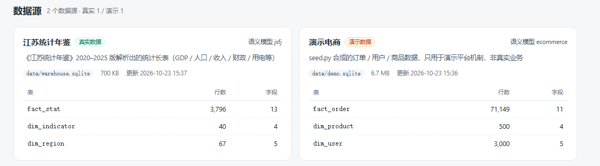

# 10 · 数据资产清单：真实数据 vs 演示数据（已物理隔离）

> 2026-10-23 盘点 + 拆分。平台里有两类数据源，分别落在两个 SQLite 文件里：
>
> - `data/warehouse.sqlite` —— **真实**：江苏统计年鉴（`fact_stat`）
> - `data/demo.sqlite` —— **演示**：合成电商（`fact_order` / `dim_user` / `dim_product`）
>
> 语义模型通过 YAML 里的 `source:` 字段绑定数据源，查询网关按模型路由到对应库。

---

## 一、结论先行

| 用途 | 数据源 | 物理文件 | 是否可以对外 |
|---|---|---|---|
| 业务分析 / 看板结论 | `jsfj`（江苏统计年鉴） | `data/warehouse.sqlite`（0.7 MB） | ✅ 真实年鉴数据 |
| 演示「问数 → 看板」机制 | `demo`（演示电商） | `data/demo.sqlite`（6.7 MB） | ❌ 合成数据，不能当业务结论 |
| 平台元数据 | — | `data/metadata.sqlite` | 看板 / 查询 / 审批记录，非业务数据 |

两个库**没有重叠的表**：真实库是 `fact_stat` + 两个维表，演示库是 `fact_order` + 两个维表。

---

## 二、真实数据源 `jsfj`（江苏统计年鉴）

| 项目 | 值 |
|---|---|
| 数据源 key | `jsfj`（`data_nature: real`） |
| 文件 | `data/warehouse.sqlite`，约 700 KB |
| 表 | `fact_stat` 3,796 行 / 13 字段；`dim_indicator` 40；`dim_region` 67 |
| 时间 | 省级 **1952–2024**；市级 2005 / 2010 / 2013–2024；县级 2024 |
| 层级 | province 1,194 行 / city 1,885 / county 717；40 个 `indicator_key` |
| 地区 | 江苏省 + 13 个设区市 + 40 个县市 + 13 个市区（67 个地区） |
| 语义模型 | `semantic/jsfj.yaml`，55 指标 / 5 维度，`source: jsfj` |

### 原始数据与加工链

| 环节 | 文件 | 说明 |
|---|---|---|
| 原始年鉴 | `data/jsfj/2020` ~ `2025`（6 版，约 22 MB） | 每版 20+ 个 xlsx，官方统计年鉴 |
| 抽取 | `tools/jsfj_etl.py` | 只写 `data/warehouse.sqlite` 的统计三表 |
| 建模 | `semantic/jsfj.yaml` | `data_nature: real` / `source: jsfj` |
| 底图 | `web/vendor/geo/*.json`（14 个，702 KB）+ `drill/`（13 个，472 KB） | DataV.GeoAtlas 真实行政区划 |

### 真实数据看板（已发布）

| 看板 | 版本 | 分享 token |
|---|---|---|
| 江苏省经济与民生概览（含13市） | v8 | `a93fa0eab65d471a` |
| 江苏县域经济专题（2024） | v12 | `416e373fbd554ee3` |
| 江苏投资与消费专题（2024） | v12 | `e879b8cdc5de4a35` |

> 链接格式：`http://127.0.0.1:8765/?share=<token>`。看板绑定 `jsfj` 模型，
> 即使当前激活的是演示模型，取数仍走真实库。

---

## 三、演示数据源 `demo`（合成电商）

| 项目 | 值 |
|---|---|
| 数据源 key | `demo`（`data_nature: demo`） |
| 文件 | `data/demo.sqlite`，约 6.7 MB |
| 表 | `fact_order` **71,149 行**（2025-09-01 ~ 2026-10-18）；`dim_user` 3,000；`dim_product` 500 |
| 语义模型 | `semantic/ecommerce.yaml`，9 指标 / 8 维度，`source: demo` |
| 知识资产 | `semantic/knowledge.yaml`（演示指标的业务解释） |
| 配套模板 | `templates/boards/business_review.yaml`（经营分析看板） |
| 生成脚本 | `server/app/seed.py`（seed=20261019，只写 demo 库） |

> GMV、订单量、客单价等全部是随机生成的，**没有任何业务含义**；
> 它的唯一用途是把平台机制跑通、给演示留一套可交互的数据。

---

## 四、数据源展示（「数据源」页面）

左侧导航新增「数据源」页，直接展示每个源的文件、大小、更新时间、绑定的语义模型、表清单和行数。
数据来自只读接口 `GET /api/sources`；健康检查 `GET /api/health` 也会分别报告两个源的可用性。

页面上的「真实数据 / 演示数据」徽标与顶部右上角一致。

---

## 五、怎么一眼区分

| 判断方式 | 真实 `jsfj` | 演示 `demo` |
|---|---|---|
| **界面徽标** | 绿色「真实数据」 | 橙色「演示数据」 |
| 数据源页 | `data/warehouse.sqlite` | `data/demo.sqlite` |
| 语义模型 | `江苏统计年鉴`，`source: jsfj` | `电商交易域`，`source: demo` |
| 物理表 | `fact_stat` / `dim_indicator` / `dim_region` | `fact_order` / `dim_user` / `dim_product` |
| 看板 | 3 个已发布的江苏专题看板 | 从「经营分析看板」模板创建的看板 |
| API | `GET /api/meta` → `model.source == "jsfj"` | 同上，值为 `demo` |

---

## 六、使用顺序与注意事项

1. **首次安装**：`python -m server.app.seed`（生成 `demo.sqlite`，可选）→ `python tools/jsfj_etl.py`（生成 `warehouse.sqlite`）
2. **两个脚本互不影响**：seed 只写 demo 库，ETL 只写统计三表；重跑任意一个都不会删另一个库
3. **默认数据源**：`config.DEFAULT_SOURCE = "jsfj"`；语义模型没写 `source` 时打到真实库
4. **切换模型 = 切换数据源**：激活 `jsfj` / `ecommerce` 时查询自动路由到对应文件
5. **备份**：`data/warehouse.sqlite`、`data/demo.sqlite`、`data/metadata.sqlite`、`semantic/`
6. 所有 SQLite 与 `data/jsfj/` 都在 `.gitignore` 里，真实数据靠「年鉴原件 + ETL」复现，不随仓库分发

---

## 七、测试 / 调试痕迹

| 对象 | 状态 |
|---|---|
| 4 条验证查询（2026-10-22 16:38） | 已删除 |
| `.pytest-meta/metadata.sqlite` | 已删除（跑测试自动重建） |
| `data/shot_*.png`（13 张）、`data/dump.html` | 已删除 |
| 空看板「我的分析看板」（0 卡片，draft v1） | 保留，可一键删除 |
| `_ldr_column_meta` | 导入功能的元数据表（空），数据源页面不展示 |

---

## 八、口径提醒

- `fact_stat` 3,796 行全部来自年鉴，没有一行合成数据
- 文档 09 第 11.2 节记录的口径差异（13 市 GDP 合计比全省多 283.43 亿、13 市用电比全省少 372.70 亿）来自年鉴本身
- 演示库与真实库不能 join，也不应该 join
